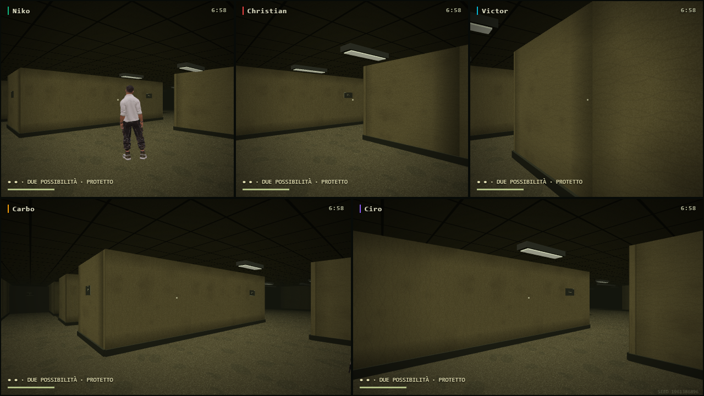
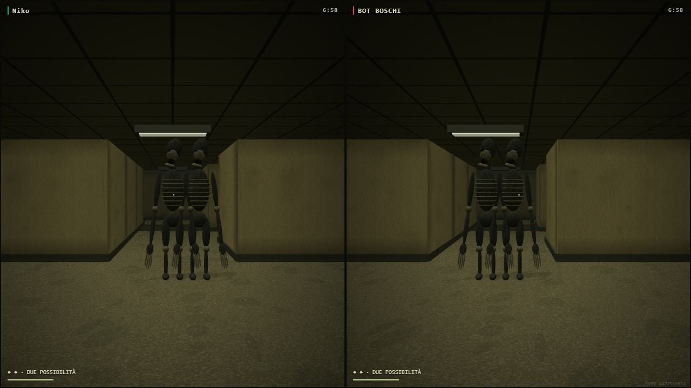
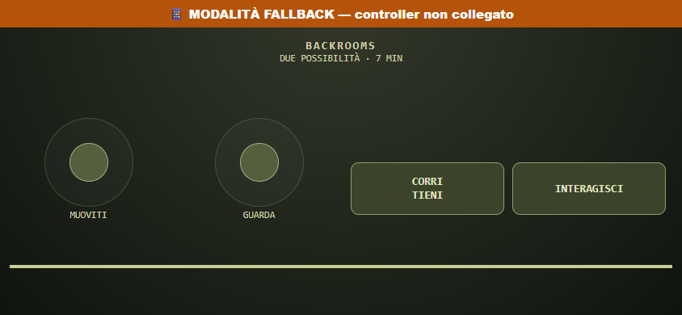
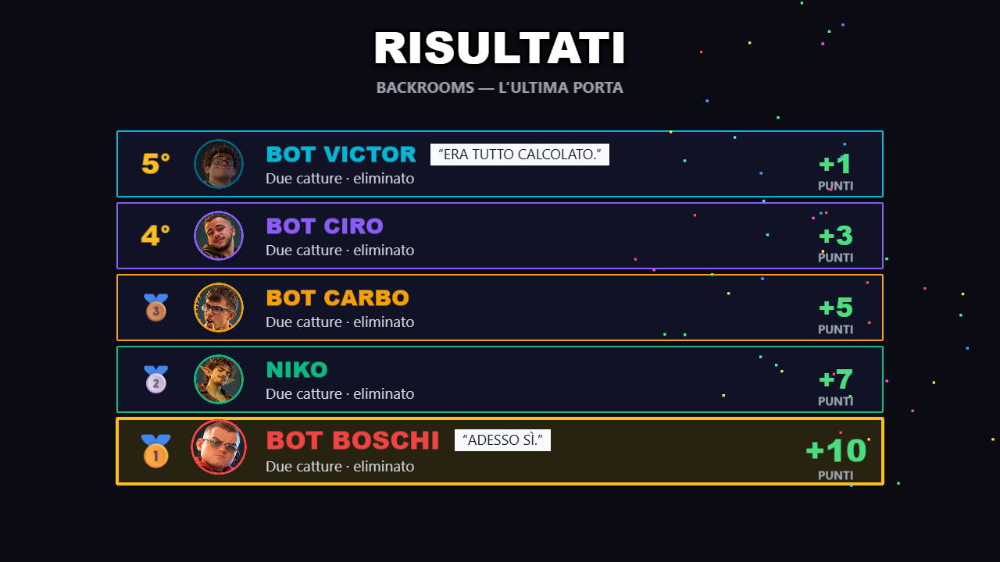

# BACKROOMS — L’ULTIMA PORTA

Il nuovo minigioco è integrato nel catalogo e nel rullo, in una cartella indipendente. Usa Phaser per il ciclo del round e Babylon per una scena condivisa con 2–5 camere in prima persona sullo schermo principale. I telefoni inviano solo comandi: nessun renderer 3D mobile. Nessuna nuova dipendenza, nessun pacchetto di asset scaricato, nessun commit/push/deploy.

## Giocare

Preview di sviluppo: http://127.0.0.1:5174/ — crea stanza, seleziona BACKROOMS e avvia. Per telefoni di amici usa l’indirizzo LAN del PC già usato dal progetto.

- Stick sinistro: movimento relativo alla visuale. Stick destro: visuale.
- LB/L 1 tenuto: corsa con fiato; recupera camminando/fermandosi. Camminare è meno rumoroso.
- A/✕: porte, chiave, interruttori, nascondigli; tenuto: generatori. Da spettatore cambia giocatore osservato.
- Telefono: due joystick indipendenti, CORRI e INTERAGISCI; supportato movimento + visuale + corsa simultanei.
- ESC: menu/pause già coerenti con gli altri giochi. Timer, movimenti e audio del minigioco si fermano.

Il timer iniziale è 7 minuti, configurabile nel modello tra 6 e 8 minuti. Prima fuga = prima posizione; gli altri continuano. La classifica ordina fuggiti per tempo, poi superstiti per vite residue e zone esplorate, infine eliminati per sopravvivenza. A parità completa usa l’ordine del roster. Criterio mostrato a fine gioco e statistiche consegnate al normale ScoreManager.

## Mappa e fuga

Mappa 17 × 17 per 2–3, 21 × 21 per 4–5, moduli da 3,2 m: DFS, stanze connesse, anelli, vicoli ciechi, porte e rifugi. Pavimento, collisioni, LOS e BFS condividono la stessa occupazione. Movimento suddiviso per evitare attraversamenti delle pareti. Porte chiuse bloccano corpi e vista, non possono chiudersi addosso a persone/creature. La generazione garantisce collegamenti; uscita e oggetti sono assegnati a celle raggiungibili.

Tre modalità, pesi iniziali uguali e configurabili in BackConfig: porta libera, chiave, puzzle. Due puzzle: tre interruttori a pressione oppure due generatori ripristinati tenendo il comando. Alimentazione persistente e condivisa. La modalità non compare nell’HUD iniziale: la porta la spiega quando viene esaminata. Chiave visibile nel mondo, senza sagoma attraverso muri; cade nella posizione della cattura e può essere recuperata.

Riproduzione DEV: aggiungi `?backroomsSeed=12345` alla preview e usa lo stesso numero di giocatori. Seed mostrato discretamente sul bordo della TV. Generazione e condizioni di fuga sono deterministiche; evita seed identici consecutivi nella normale estrazione.

## Catture e mostri

Due catture: prima = primo piano 3D locale, breve blackout, oggetti lasciati, ritorno allo spawn, 7 s di immunità; seconda = eliminazione e spettatore passivo. Esplorazione conservata dopo il primo reset. Cinque punti separati nella stessa stanza iniziale evitano corpi addosso alle camere; ogni giocatore mantiene il proprio punto di respawn. Immunità iniziale 8 s. Lo spawn non conferisce invulnerabilità permanente: le destinazioni delle pattuglie lo evitano, ma i percorsi possono attraversarlo dopo la protezione iniziale. Nessuna barriera invisibile permanente; immunità individuale al respawn e creature libere di uscire.

Stalker: passo lento, osservazione prima della pressione. Corridore: più veloce, reagisce fortemente al rumore. Imitatore: usa il renderer/skin di un giocatore, rivela la creatura a distanza ravvicinata, senza targhetta rivelatrice. Uno/due mostri casuali, privilegiando una sola presenza nelle stanze con due giocatori.

Percezione: cono visivo, distanza, oscurità, LOS con muri/porte, rumori con attenuazione, posizione sentita come snapshot e memoria di 5 s. Navigazione BFS per centri delle celle, senza tagliare gli angoli. Ricerca dopo perdita della vista, poi nuova pattuglia. Una memoria visiva recente non viene cancellata da un passo più vecchio: nascondersi in piena vista non rende invulnerabili. Cattura comporta una pausa della creatura; destinazioni di pattuglia evitano uscita, chiave, puzzle e spawn. Nessun combattimento o abilità aggiunti agli altri giochi.

## Direzione visiva e audio

Materiali originali: carta da parati ripetitiva/macchiata, moquette con fibre e macchie, controsoffitto, neon, porte, targhe, sedute e armadi. Creature originali articolate, con anatomia allungata, costole, mandibola, denti e dita; non cubi/capsule di debug. Quattro modelli Tripo esistenti riutilizzati senza cambiare texture/rig; Victor conserva il renderer già disponibile. Oggetti decorativi non indispensabili non ostacolano la navigazione.

Nebbia e far plane limitano la visibilità. Geometria statica unita per materiale in chunk spaziali, per mantenere culling e contenere drawcall. Ombre della creatura solo con 2–3 visuali e qualità adeguata; ombre disattivate con 4–5 per mantenere il budget. Auto-quality esistente preservata.

Audio sintetizzato sul mixer esistente, con volumi/muto: ronzio, silenzi, passi, scricchiolii, rumori e catture. Panning rispetto alla camera/finestra più vicina; muri attenuano i suoni. Su una TV c’è un solo mix condiviso, non cinque uscite audio isolate. Due oscillatori continui e massimo 12 voci transienti. Tema musicale dedicato silenzioso: nessuna batteria/melodia party durante l’esplorazione.

È una prima direzione artistica originale e giocabile. Per una successiva rifinitura visiva: sculpt/texture professionali delle creature, animazioni manuali d’attesa/ricerca e registrazioni Foley ambientali. Non sono dipendenze mancanti per usare questa versione. Paura, difficoltà percepita, orientamento e divertimento richiedono un playtest umano: i test automatici non li certificano.

## Verifiche

- 4000 mappe: 1000 seed× 2/3/4/5; connessione, uscita, oggetti, spawn, seed riproducibile, nessuna topologia duplicata nel campione 1000.
- 39 gruppi di test puri: collisione/LOS/porte, entrambi puzzle, chiave lasciata e recuperata, due catture, immunità, spawn temporaneo, hiding visto/non visto, memoria finita, Imitatore e navigazione reale delle creature attraverso svolte. Tutti i bot possono fuggire senza interferenza delle creature; con i mostri gli esiti includono fughe, eliminazioni e timeout.
- 11 suite di regressione: Backrooms, FPS ADS, Geofall, gamepad, abilità 65, round, bot solo, audio, Minigolf, qualità e animazioni personaggi.
- Stanze server reali 2/3/4/5 fino alla classifica e alla lobby: umano test guidato come bot per accelerare la simulazione, senza forzare `finish`. Esiti e punti in rooms.json. Distinguere questa prova dal test compilato in tempo reale.
- Browser 5 telefoni + pad simulati Xbox/PS/generico; input reale InputManager, touch CDP a 3 dita, pausa, fallback/rejoin, catture e spettatore. Interazione singola anche quando lo stesso edge viene letto da più sotto-passi di un frame lento.
- Screenshot TV 1280 × 720,1920 × 1080,800 × 600; telefoni 390 × 800,360 × 640,844 × 390. Immagini effettivamente aperte/ispezionate; corretto titolo coperto dal badge fallback. Fixture visive distinte dalle partite naturali.
- Render 5 camere a 1280 × 720: circa 60FPS,180 frame reali, NVIDIA RTX 3050/ANGLE D 3D 11; dati in browser.json. Non è un benchmark per hardware integrato o altri browser.
- Quattro cicli di lifecycle: due ronzii realmente terminati, zero voci transienti, loop fermati, HUD rimosso, un solo canvas Phaser in lobby e controller telefono ripulito. Non è un audit completo dell’heap.
- Geofall renderer/regole/domande invariati per hash rispetto alla verifica precedente; regressione browser 5 p passata. Sparatoria:5 viewport, ADS,6 mirini, touch 3 dita, rinculo/hit e fine round passati.
- Typecheck e build finale riusciti. Restano i warning preesistenti sui grandi chunk condivisi Babylon/main/nativeXR; il modulo Backrooms è caricato lazy.

Test compilato finale completato: menu reale, chunk lazy, quattro GLB HTTP200, telefono senza canvas3D, quattro bot, nessun import DEV o risultato forzato. Fine naturale dopo 275.315s reali; umano AFK catturato, respawnato e poi eliminato (2→1→1→0 vite). Classifica regolare e zero pageerror. Dettagli in FINAL-VERIFICATION.json e production.json. La precedente prova di7minuti è conservata in before-spawn-fix.

Non verificati: gamepad fisici, iOS/Android reali, altro hardware e playtest con amici. Nessuna dichiarazione di regressione esaustiva di ogni gioco/manualità.

Il solo file generato dist/index.html viene ripristinato dopo QA secondo la procedura già usata nel progetto; per avviare questa versione in produzione eseguire di nuovo `npm run build`. La preview Vite 5174 rimane disponibile con i sorgenti correnti.

## Immagini controllate

