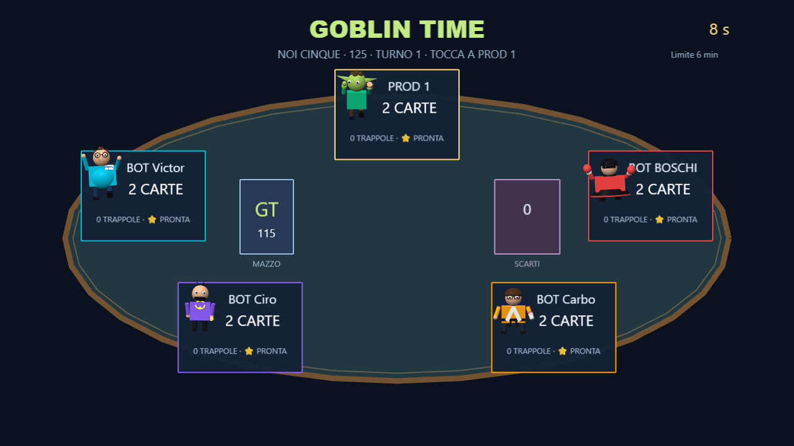
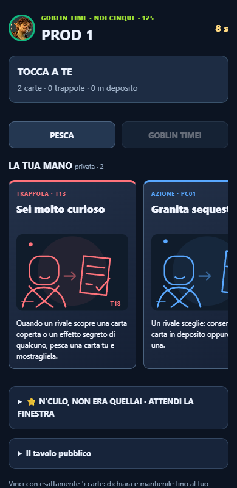
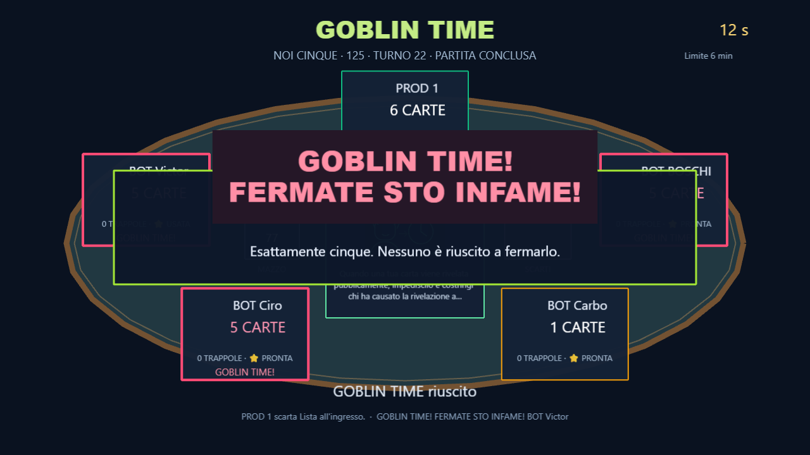

# GOBLIN TIME — implementazione e verifiche

Verificato il 13 ottobre 2026. ID `goblinTime`, CULTURA, rare, PHONE_TEXT, 2–5 giocatori. Aggiunto come sedicesimo gioco: il numero #14 dell'allegato è storico e non sostituisce Geofall né gli altri 15 giochi.

## Giocare

Apri http://localhost:3002/, crea la stanza, collega i telefoni dal QR e scegli GOBLIN TIME nella selezione manuale, oppure attendi l'estrazione nel rullo. Il tavolo propone **MAZZO ORIGINALE** (100) e **NOI CINQUE** (125). Il server serve la build compilata dalla stessa origine, anche ai telefoni sulla LAN. I comandi funzionano su HTTP senza dipendere da crypto.randomUUID disponibile solo in contesti sicuri.

## Realizzato

- 100 effetti originali e 25 personalizzati: handler espliciti, nessuna interpretazione del testo naturale delle carte.
- Base: 40 AZIONI, 25 TRAPPOLE, 20 RISPOSTE, 15 CATASTROFI. Variante: 50/30/25/20. Una copia per ID.
- Due carte iniziali; PESCA conserva una fra due, GIOCA e ARMA; due slot ordinari, carte RISPOSTA contestuali; limite mano9.
- Dichiarazione fuori turno nei momenti stabili della risoluzione. Vittoria solo al successivo turno effettivo, dopo debiti, depositi, trappole e reazioni. Ogni passaggio diverso da cinque annulla immediatamente l'annuncio.
- Cinque abilità una volta per partita, numeri e descrizioni nel catalogo comune; stato server pubblicato sull'AbilityHub. Goblin ha una decisione dedicata di 3s dopo PESCA, sospesa in pausa.
- Tavolo Phaser, modelli procedurali e animazioni già presenti, spostamenti di carte coperte, trappole, catastrofi e grande annuncio GOBLIN TIME. Nessuna modifica ai modelli degli altri giochi.
- Mano privata scorrevole con SVG originali, dettagli completi, scelta di bersagli, voti simultanei, ordine del mazzo, reazioni, deposito e trappole proprie. Scorrimento e pannelli aperti conservati durante gli aggiornamenti.
- Bot che usano i medesimi comandi validati degli umani, guardano solo le proprie opzioni e informazioni autorizzate, dichiarano, sabotano e usano abilità.
- Conclusione per tempo con classifica tecnica; nessuna falsa vittoria GOBLIN TIME. ScoreManager esistente assegna i punti e l'eventuale modificatore PUNTI DOPPI.

## Architettura e privacy

Il motore vive solo in `server/goblinTime/`. Le coroutine sospendono le transazioni su decisioni o reazioni; il clock è server e non dipende dagli FPS della TV. Catalogo, contratti e illustrazioni stanno in `shared/goblinTime/`. La TV usa `src/minigames/goblinTime/`; il telefono `src/controller/goblinTimeController.ts`.

Il socket stabilisce il giocatore: playerId inviati nel payload non possono impersonare altri. Comandi con round, partita, versione, richiesta e decisione obsoleti vengono rifiutati. Le richieste ripetute accettate restituiscono l'ack precedente senza eseguire di nuovo l'effetto. Il vecchio socket non può più pilotare dopo la riconnessione. Un riavvio cambia matchId.

La proiezione pubblica contiene esclusivamente conteggi, slot, turno, timer, annunci, abilità usate, scarti e carte effettivamente pubbliche. Le mani, i nomi delle trappole coperte, le offerte, le scelte e le informazioni osservate vanno al rispettivo socket. L'host non riceve queste proiezioni private e non può inviare snapshot o risultati arbitrari per GOBLIN TIME. Una rivelazione negata da R14 non viene recuperata tramite la successiva scelta di A12/A40.

Il generatore deterministico server deriva i sorteggi con SHA-256 da una chiave UUID segreta per partita; i seed numerici sono solo per le simulazioni riproducibili. La chiave non entra nei payload. Ogni movimento verifica che tutte le carte rimangano in una sola zona; la zona temporanea deve essere vuota al termine della transazione.

## Decisioni di risoluzione

- Scelta principale12s, decisioni12s, reazioni5s, cap360s. Pausa sospende tutti i timer, inclusi i4s di conclusione prima dei risultati. Il limite chiude una transazione già iniziata prima di assegnare la classifica tecnica.
- Le scelte simultanee vengono raccolte senza pubblicarle e risolte in ordine di turno. Le trappole si ordinano per armamento e si consumano prima della risposta R06; il trigger si ricontrolla quando necessario.
- Una RISPOSTA per giocatore/evento e massimo quattro nella catena. R11 copia una risposta risolta nello stesso contesto di evento; le sue eventuali scelte native vengono mostrate al copiante. Nessuna copia di copia. T09 intercetta anche l'annullamento di una trappola.
- Dopo la risoluzione di una perdita o un guadagno, eventi HandChanged fanno funzionare T04/T15/T20 anche su recuperi, scambi, deposito, trappole e abilità. Scambi simultanei conservano il conteggio netto; C09/C13 annullano comunque gli annunci come richiesto.
- I debiti si pagano prima della vittoria, con le carte effettivamente disponibili. Un bersaglio impossibile viene saltato o usa il ripiego PESCA previsto dal catalogo; i requisiti espliciti della carta prevalgono. Nessuna carta viene inventata.
- A35 aggiunge al massimo uno slot ausiliario oltre ai due ordinari. La sospensione di A36 termina al prossimo turno dell'autore anche quando cambiano ordine o turni extra.
- C15 impedisce di dichiarare finché non avviene un'altra variazione reale della mano. Arrivare nuovamente a cinque non ripristina un annuncio annullato.
- Timeout: prima scelta legale nell'ordine mostrato; nelle reazioni PASSA, negli scarti facoltativi zero carte. Gli obblighi impossibili non bloccano il tavolo.
- A39 blocca gioco e scarto volontario della carta; doni, scambi, depositi e perdite forzate restano operazioni distinte. Bloccare le RISPOSTE non disattiva le abilità, che non sono carte.

## Verifiche

| Verifica | Risultato |
|---|---|
| Catalogo, singole carte, interazioni, invarianti e bot | 241 controlli passati, inclusi125 casi nominati per carta |
| Simulazioni naturali | 96 partite seedate, 2–5 bot, entrambi i mazzi, tutte concluse |
| Autorizzazione, privacy, duplicati, riconnessione e riavvio | 17 controlli passati |
| Browser dev | 5 partite: 2/3/4/5 telefoni e 1 telefono+4 bot; pausa, ricarica telefono, risultati, nessun overflow mobile o errore JS |
| Bundle compilato | 2 telefoni e 1 telefono+4 bot; vittoria, punti, assenza di mani private sulla TV, distruzione del canvas3D; crypto.randomUUID disattivata sui telefoni |
| Regressioni | abilità1186/1186, round58 controlli, controller e audio passati |
| Build | TypeScript e Vite passati; resta l'avviso preesistente sui chunk grandi |

Comandi riproducibili:

```powershell
npx tsx scripts/goblin-time-selftest.ts
npx tsx scripts/goblin-time-network-selftest.ts
npx tsx scripts/ability-selftest.ts
npx tsx scripts/pad-selftest.ts
npx tsx scripts/rounds-selftest.ts
npx tsx scripts/audio-selftest.ts
npm run build
# Server aggiornato3002 e Vite5175 con VITE_SERVER_URL=http://localhost:3002
$env:HOST_URL='http://127.0.0.1:5175/'
$env:CTRL_URL='http://127.0.0.1:5175/controller.html'
$env:GOBLIN_GPU='1'
node scripts/e2e/goblin-time.mjs
# Bundle compilato sulla porta3002, senza Vite
$env:PROD_HOST='http://localhost:3002/'
$env:CTRL_URL='http://localhost:3002/controller.html'
node scripts/e2e/goblin-time-prod.mjs
```

## Prestazioni misurate

Chrome con GPU reale NVIDIA RTX3050, Direct3D11, canvas1280×720, misure di3s sul tavolo dopo il caricamento iniziale. Le miniature usano i rig procedurali esistenti e non caricano i GLB dettagliati.

| Giocatori | Mazzo | FPS | Frame p95 |
|---|---|---:|---:|
| 2 | 100 | 59.9 | 16.8ms |
| 5 | 125 | 59.9 | 16.8ms |

Queste misure riguardano il tavolo su questo PC; non costituiscono una prova per tutti i dispositivi o per ogni concatenazione di effetti. I telefoni sono emulati a390px e usano DOM/SVG, senza rendering3D.

## Immagini verificate







Ulteriori immagini e risultati: cartelle `browser/` e `production/`; file `core-tests.json` e `network-tests.json`.

## Stato delle125 carte

Ogni riga ha un handler effettivo e un test dedicato passato. Le100 originali non sono state rinominate o sostituite. SHA-256 del catalogo originale copiato: `9320597fff8ea062056d3b58587f4e982ac895362d18eb31c643487e3a9002ad`.

| ID | Tipo | Carta | Stato |
|---|---|---|---|
| A01 | AZIONE | Furto con ricevuta | Implementata · test passato |
| A02 | AZIONE | Cambio di tasca | Implementata · test passato |
| A03 | AZIONE | Scontrino gonfiato | Implementata · test passato |
| A04 | AZIONE | Resto sbagliato | Implementata · test passato |
| A05 | AZIONE | Finta beneficenza | Implementata · test passato |
| A06 | AZIONE | Ultima goccia | Implementata · test passato |
| A07 | AZIONE | Sequestro temporaneo | Implementata · test passato |
| A08 | AZIONE | Cassa comune | Implementata · test passato |
| A09 | AZIONE | Telefono scarico | Implementata · test passato |
| A10 | AZIONE | Fidati di me | Implementata · test passato |
| A11 | AZIONE | Patto a metà | Implementata · test passato |
| A12 | AZIONE | Smaschera il furbo | Implementata · test passato |
| A13 | AZIONE | Bonus di presenza | Implementata · test passato |
| A14 | AZIONE | Bancomat rotto | Implementata · test passato |
| A15 | AZIONE | Debito di famiglia | Implementata · test passato |
| A16 | AZIONE | Reso non autorizzato | Implementata · test passato |
| A17 | AZIONE | Sciopero di quartiere | Implementata · test passato |
| A18 | AZIONE | Doppio gioco | Implementata · test passato |
| A19 | AZIONE | Conto alla rovescia | Implementata · test passato |
| A20 | AZIONE | Prima io | Implementata · test passato |
| A21 | AZIONE | Giro di boa | Implementata · test passato |
| A22 | AZIONE | Io non c'ero | Implementata · test passato |
| A23 | AZIONE | Controllo antidoping | Implementata · test passato |
| A24 | AZIONE | Tre sul tavolo | Implementata · test passato |
| A25 | AZIONE | Sanzione social | Implementata · test passato |
| A26 | AZIONE | Pignoramento | Implementata · test passato |
| A27 | AZIONE | Prestito lampo | Implementata · test passato |
| A28 | AZIONE | Falsa sicurezza | Implementata · test passato |
| A29 | AZIONE | Passaparola | Implementata · test passato |
| A30 | AZIONE | Prima paghi tu | Implementata · test passato |
| A31 | AZIONE | Terzo incomodo | Implementata · test passato |
| A32 | AZIONE | Silenzio stampa | Implementata · test passato |
| A33 | AZIONE | Tagliando vincente | Implementata · test passato |
| A34 | AZIONE | Mini truffa | Implementata · test passato |
| A35 | AZIONE | Evasione creativa | Implementata · test passato |
| A36 | AZIONE | Sospensione cautelare | Implementata · test passato |
| A37 | AZIONE | Proposta indecente | Implementata · test passato |
| A38 | AZIONE | Deposito cauzionale | Implementata · test passato |
| A39 | AZIONE | Regalo avvelenato | Implementata · test passato |
| A40 | AZIONE | Ultimo screenshot | Implementata · test passato |
| T01 | TRAPPOLA | Mani lunghe, mani vuote | Implementata · test passato |
| T02 | TRAPPOLA | Pesca a strascico | Implementata · test passato |
| T03 | TRAPPOLA | C'è Goblin Time? | Implementata · test passato |
| T04 | TRAPPOLA | Troppa grazia | Implementata · test passato |
| T05 | TRAPPOLA | Occhio alla mano | Implementata · test passato |
| T06 | TRAPPOLA | Tassa sulle trappole | Implementata · test passato |
| T07 | TRAPPOLA | Carta bollata | Implementata · test passato |
| T08 | TRAPPOLA | Assicurazione fasulla | Implementata · test passato |
| T09 | TRAPPOLA | Non vale, ma vale | Implementata · test passato |
| T10 | TRAPPOLA | Indirizzo sbagliato | Implementata · test passato |
| T11 | TRAPPOLA | Notaio infame | Implementata · test passato |
| T12 | TRAPPOLA | Falso straordinario | Implementata · test passato |
| T13 | TRAPPOLA | Sei molto curioso | Implementata · test passato |
| T14 | TRAPPOLA | Consegna respinta | Implementata · test passato |
| T15 | TRAPPOLA | Ultimo centesimo | Implementata · test passato |
| T16 | TRAPPOLA | Scarto mio | Implementata · test passato |
| T17 | TRAPPOLA | Porta in faccia | Implementata · test passato |
| T18 | TRAPPOLA | Bomba a orologeria | Implementata · test passato |
| T19 | TRAPPOLA | Clausola nascosta | Implementata · test passato |
| T20 | TRAPPOLA | Che ti ridi? | Implementata · test passato |
| T21 | TRAPPOLA | Multa per eccesso | Implementata · test passato |
| T22 | TRAPPOLA | Chiusa per ferie | Implementata · test passato |
| T23 | TRAPPOLA | Neanche per sogno | Implementata · test passato |
| T24 | TRAPPOLA | Prendi due, dai tre | Implementata · test passato |
| T25 | TRAPPOLA | Scambio sospetto | Implementata · test passato |
| R01 | RISPOSTA | Nun ce provà | Implementata · test passato |
| R02 | RISPOSTA | Rigira la frittata | Implementata · test passato |
| R03 | RISPOSTA | Taschine chiuse | Implementata · test passato |
| R04 | RISPOSTA | Casco da cantiere | Implementata · test passato |
| R05 | RISPOSTA | Ultima bastardata | Implementata · test passato |
| R06 | RISPOSTA | Trappola? Quale trappola? | Implementata · test passato |
| R07 | RISPOSTA | Sono fuori | Implementata · test passato |
| R08 | RISPOSTA | Rinviato al mittente | Implementata · test passato |
| R09 | RISPOSTA | Scelta mia | Implementata · test passato |
| R10 | RISPOSTA | Non così tanto | Implementata · test passato |
| R11 | RISPOSTA | Fotocopia illegale | Implementata · test passato |
| R12 | RISPOSTA | Ultimo respiro | Implementata · test passato |
| R13 | RISPOSTA | Gira a destra | Implementata · test passato |
| R14 | RISPOSTA | Privacy, grazie | Implementata · test passato |
| R15 | RISPOSTA | Consegna intercettata | Implementata · test passato |
| R16 | RISPOSTA | Ti sei allargato | Implementata · test passato |
| R17 | RISPOSTA | Beccato con le mani | Implementata · test passato |
| R18 | RISPOSTA | Riscatto immediato | Implementata · test passato |
| R19 | RISPOSTA | Un attimo prima | Implementata · test passato |
| R20 | RISPOSTA | Carta coperta | Implementata · test passato |
| C01 | CATASTROFE | Riunione condominiale | Implementata · test passato |
| C02 | CATASTROFE | Blackout totale | Implementata · test passato |
| C03 | CATASTROFE | Cambio di identità | Implementata · test passato |
| C04 | CATASTROFE | Gogna pubblica | Implementata · test passato |
| C05 | CATASTROFE | Mercatino abusivo | Implementata · test passato |
| C06 | CATASTROFE | Sequestro di reazioni | Implementata · test passato |
| C07 | CATASTROFE | Processo sommario | Implementata · test passato |
| C08 | CATASTROFE | Ultima chiamata | Implementata · test passato |
| C09 | CATASTROFE | Colpo di stato | Implementata · test passato |
| C10 | CATASTROFE | Redistribuzione maledetta | Implementata · test passato |
| C11 | CATASTROFE | Rubinetto di cavolate | Implementata · test passato |
| C12 | CATASTROFE | Ispettore delle trappole | Implementata · test passato |
| C13 | CATASTROFE | Cambio di tavolo | Implementata · test passato |
| C14 | CATASTROFE | Finta pace | Implementata · test passato |
| C15 | CATASTROFE | Reset bastardo | Implementata · test passato |
| PG01 | AZIONE | L'ho fatto io 'sto gioco | Implementata · test passato |
| PG02 | AZIONE | Rimonta al 90° | Implementata · test passato |
| PG03 | TRAPPOLA | Jäger sul regolamento | Implementata · test passato |
| PG04 | RISPOSTA | Rollback istintivo | Implementata · test passato |
| PG05 | CATASTROFE | Patch del venerdì sera | Implementata · test passato |
| PB01 | AZIONE | Documento, prego | Implementata · test passato |
| PB02 | AZIONE | Mo m'impegno | Implementata · test passato |
| PB03 | TRAPPOLA | Lista all'ingresso | Implementata · test passato |
| PB04 | RISPOSTA | Aspè... famme capì | Implementata · test passato |
| PB05 | CATASTROFE | Buttafuori dal tavolo | Implementata · test passato |
| PV01 | AZIONE | Tutto calcolato. Più o meno | Implementata · test passato |
| PV02 | AZIONE | 20 kg in un mese | Implementata · test passato |
| PV03 | TRAPPOLA | Sveglia in ritardo | Implementata · test passato |
| PV04 | RISPOSTA | Occhio aperto | Implementata · test passato |
| PV05 | CATASTROFE | Pausa sul divano | Implementata · test passato |
| PC01 | AZIONE | Granita sequestrata | Implementata · test passato |
| PC02 | AZIONE | Ippon di carte | Implementata · test passato |
| PC03 | TRAPPOLA | Granita finita | Implementata · test passato |
| PC04 | RISPOSTA | Angora che dici? | Implementata · test passato |
| PC05 | CATASTROFE | Casa mia, regole mie | Implementata · test passato |
| PI01 | AZIONE | 50 e 50: 80 a me | Implementata · test passato |
| PI02 | AZIONE | Non c'ho spicci | Implementata · test passato |
| PI03 | TRAPPOLA | Bonifico in lavorazione | Implementata · test passato |
| PI04 | RISPOSTA | Te ne do meno | Implementata · test passato |
| PI05 | CATASTROFE | Il conto lo dividiamo | Implementata · test passato |

## Limiti e lavoro umano

L'obiettivo3–6min è da misurare con persone: gli script scelgono immediatamente e le partite automatiche risultano molto più rapide. Il limite360s e la classifica tecnica sono verificati. Il bilanciamento delle carte e delle abilità richiede playtest reali; nessun fine tuning è stato spacciato per convalidato.

Riconnessione conserva lo stato sullo stesso server; un riavvio del processo server perde le stanze in memoria, come nell'architettura esistente. Non sono stati introdotti salvataggi permanenti. La vibrazione sui telefoni fisici dipende dal browser e dal gesto dell'utente.

Nessuna nuova libreria, nessun servizio remoto, nessun nuovo personaggio e nessuna modifica al ScoreManager. I due log preesistenti graphics-performance rimangono modificati dal loro server. La build mantiene dist/index.html coerente con i nuovi chunk. Nessun commit, push o pubblicazione eseguiti.
