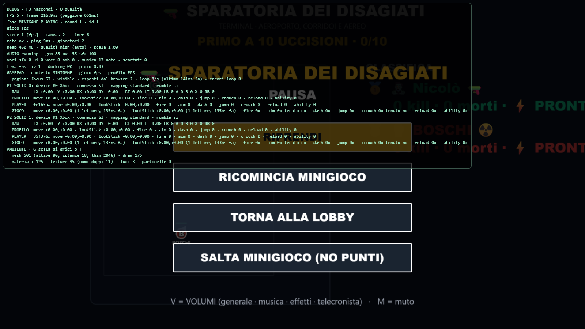
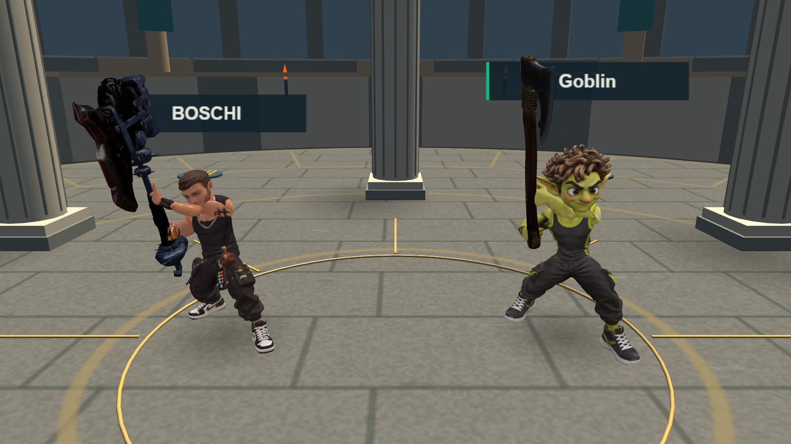
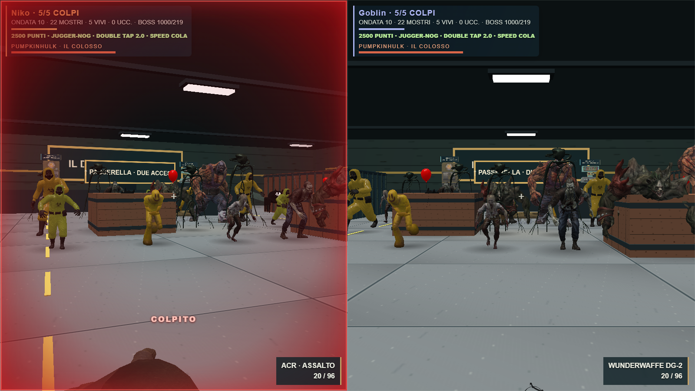

# Collisioni, pausa e danni

- Sparatoria: collisioni del corpo per 180.522 triangoli originali di Terminal, comprendenti sedute, tavoli, carrelli e strutture dell'aereo. Il movimento conserva il grafo delle scale; le nuove collisioni sono separate dalle regole balistiche. Recupero automatico su una posizione sicura in caso di perdita anomala del pavimento, senza aggiungere morti. Il canvas 3D viene nascosto durante la pausa per rendere visibile il menu Esc.
- Minigolf: contatti su facce, bordi e angoli delle superfici importate e sui lati, fondi e bordi dei percorsi procedurali. Le rampe trasferiscono la velocità verso l'alto e aggiungono una spinta limitata ai colpi forti. Gravità, buche e ripartenza dal tee restano attive; i putt conservano il comportamento precedente.
- Ferro e Furia: entrambi i GLB forniti erano già integrati. Verificati i modelli reali delle due asce; il telefono ora mostra il nome della variante selezionata. Le statistiche restano identiche.
- Orda: sfumatura rossa, bordo e scritta COLPITO per circa 0,65 secondi. Solo la visuale del ferito viene colorata. Colpi successivi riattivano il feedback; anche una riduzione degli HP ricevuta senza evento cosmetico lo attiva. La schermata di eliminazione resta libera dall'effetto.

## Verifica

Typecheck superato. Controlli mirati: collisioni da entrambi i lati e dal basso, collisioni FPS in cammino e salto, dodici buche, rampe a 30/60/120 Hz, bordi, 48 combinazioni di mappa/partecipanti e completamento dei due percorsi importati con i bot di produzione. Nel caso di prova della rampa, il colpo massimo raggiunge circa 2,22 m sopra il piano di arrivo, con scarto fra frequenze inferiore a 0,005 m.

Verificati quattro percorsi di accesso alla cabina di Terminal, atterraggio nell'aereo e coperture esistenti. Browser reale con due identità umane e pad simulati: Esc e ripresa, recupero da posizione sotto terra senza morte, caricamento delle nuove collisioni e dei due modelli di ascia. Prova Orda: nessun flash per i danni ai bot o all'altro giocatore, dissolvenza completa, riattivazione, HP senza evento e pulizia all'eliminazione. Verificato il comando cosmetico del telefono. Nessun controller fisico dichiarato testato.

Build finale superata in 3m 57s, con il solo avviso sulle dimensioni di alcuni bundle. Verificati anche l'entrypoint di produzione e l'asset delle collisioni serviti dal backend locale. Esito registrato in `build.log` e `production.json`. Dati verificabili in `physics.json`, `navigation-props.json`, `browser.json`, `orda-browser.json` e `terminal-props.json`.

Limiti: intervento sulla geometria aggiuntiva di Terminal; non costituisce una verifica manuale di ogni decorazione di tutte le mappe. Nessun cambiamento alle collisioni degli spari. Le modifiche già presenti nel workspace prima dell'intervento sono conservate separatamente.

